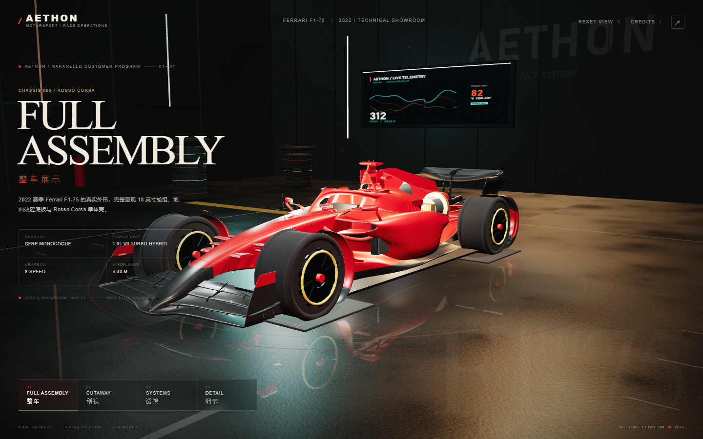
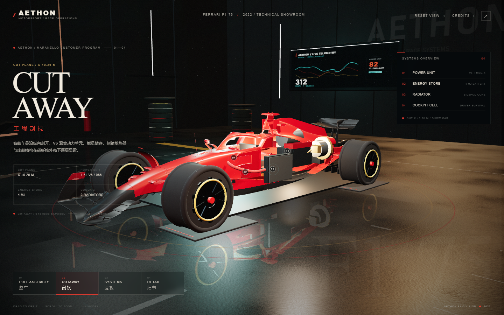
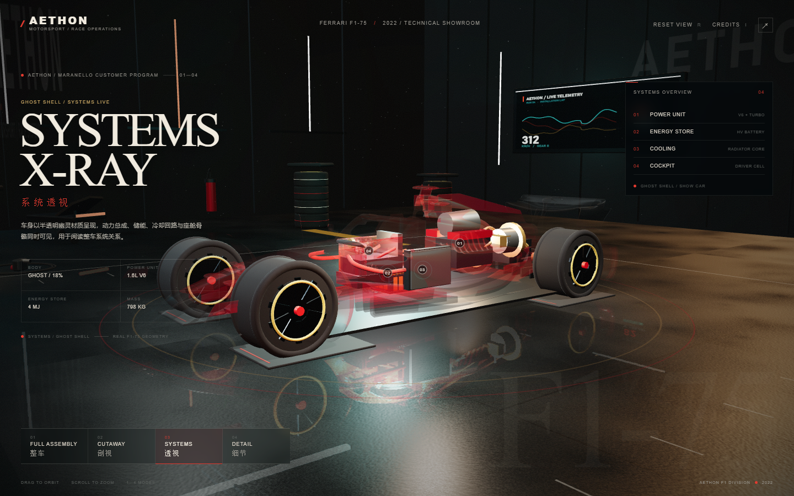

# FERRARI F1-75 — AETHON Technical Showroom

Ferrari F1-75（2022）的静态实时技术展台：真实赛车外形、Rosso Corsa 车漆、重新构建的 18 英寸轮组、程序化 V6 混动内部结构，以及 AETHON 车库的展示灯光。



> **V1 完整保留在 [`legacy/f1-garage`](legacy/f1-garage/README.md)。** V1 是带完整装配、工程剖视、半剖扫描和爆炸拆解的静态技术版。本版 V2 按静态展台重新制作，不再包含电影时间线或发车镜头。

## V2 改动

- **真实 Ferrari F1-75（2022）几何**：约 57.4 万三角面的 F1-75 外形，2022 规则前翼、地面效应底板、侧箱、halo、18 英寸轮组与尾翼。模型来源与许可见下方。
- **重新制作的材质**：Rosso Corsa 清漆车漆、碳纤维前翼/底板/尾翼、金属轮辋、刹车盘与卡钳、Pirelli 黄色轮圈标识。
- **重建轮组**：源模型没有独立轮组，本版重建四个轮组、辐条、轮辋唇、中心锁和碳陶刹车。
- **程序化 V6 混动内部**：1.6L V6、涡轮、进气、排气、变速箱、4 MJ 能量储存、侧箱散热器、座舱单元与线束。用于剖视和透视模式。
- **四个静态模式**：完整装配、工程剖视、系统透视、细节研究。没有播放按钮，没有时间线。
- **展台场景**：AETHON 车库、灯光、反射地面、遥测屏、轮胎架、工具与工作台；ACES 色调映射和 CSS 胶片颗粒。
- **完整交互**：拖拽环绕、滚轮缩放、模式切换、键盘快捷键、credits、全屏。




## 运行

```bash
cd f1-cinematic
npm install
npm run build
npm run preview
# http://127.0.0.1:4199
```

F1-75 GLB 是 21.4 MB 的外部资产，必须通过 HTTP 访问；直接双击 `dist/index.html` 会被浏览器的 CORS 拦截。

## 操作

| 操作 | 功能 |
| --- | --- |
| 拖拽 | 环绕车辆 |
| 滚轮 | 缩放 |
| `1` — `4` | 切换模式 |
| 点击底部模式栏 | 切换模式 |
| `R` | 重置当前视角 |
| `I` | 打开 credits |
| `F` | 全屏 |
| `Esc` | 关闭 credits |

## 模式

| 模式 | 内容 |
| --- | --- |
| 01 FULL ASSEMBLY / 整车 | 完整 F1-75 静态展示，默认前 3/4 视角 |
| 02 CUTAWAY / 剖视 | 沿 X +0.26 m 剖开右舷车壳，露出 V6、能量储存、散热器、座舱与线束 |
| 03 SYSTEMS / 透视 | 车身幽灵化，显示动力、储能、冷却和座舱系统的空间关系 |
| 04 DETAIL / 细节 | 前翼、轮组、刹车和推杆悬挂的特写 |

## 关于模型与范围

- 使用的 **Ferrari F1-75（2022）** 源文件是一个单壳外形模型，原始镜像没有可用贴图，`COLOR_0` 顶点色也全部为零。因此本版没有伪造原厂赞助涂装，而是重新绘制为 Rosso Corsa 展示车，并程序化补齐轮组和内部结构。
- 源模型是单壳，无法真实拆成 V1 那种独立总成；因此本版不提供“假爆炸拆解”或半剖扫描。V1 的完整装配/剖视/半剖/爆炸仍保留在 [`legacy/f1-garage`](legacy/f1-garage/README.md)。
- Ferrari 名称、F1-75 车型与相关标识属于 Ferrari；本作为独立粉丝展示，不是官方产品。

## 项目结构

```text
f1-cinematic/
├─ assets/
│  ├─ ferrari-f1-75.glb     # F1-75 外形（CC BY 4.0）
│  └─ MODEL-CREDIT.md
├─ src/
│  ├─ main.js               # 场景、灯光、相机、模式
│  ├─ ui.js                 # 静态展台 UI / 模式 / pins / credits
│  ├─ index.html
│  ├─ styles.css
│  ├─ f1/
│  │  ├─ f175Car.js         # GLB 规范化、轮组、车漆、V6 内部、剖切
│  │  └─ garage.js          # AETHON 车库、屏幕、道具、灯光
│  └─ lib/                  # 几何、纹理、静态合并
├─ scripts/
│  ├─ build.mjs             # 构建并复制 GLB
│  ├─ serve.mjs             # 本地 HTTP 服务
│  ├─ capture.mjs           # 重拍预览图
│  ├─ verify.mjs            # 静态展示回归测试
│  └─ harness.mjs
├─ legacy/f1-garage/        # 完整保留的 V1（含单文件 dist）
├─ preview-*.png
└─ README.md
```

## 验证

```bash
npm run verify
```

当前版本覆盖：启动、loader、整车加载、画布尺寸、桌面无溢出、四模式、剖视裁切、透视幽灵材质、细节复位、pins、重置反馈、credits、键盘快捷键、无控制台错误、移动端布局与模式切换。

本次交付：**27/27 通过**。测试环境为 headless Chrome（D3D11）。1440×900 实测约 **142 fps**；静态场景没有后处理链，帧率由设备与 DPR 决定。

## 资产许可与致谢

- **Ferrari F1-75 (2022) 3D model** — ZionCaesar & Sketcher, licensed **CC BY 4.0**, distributed via [FetchCFD / Alges Mann](https://fetchcfd.com/view-project/3603).
- 本版对几何进行了缩放、重设轮组、重绘车漆、添加程序化内部结构、灯光与展示场景。原始几何和设计权利归原作者/权利人所有。
- **Ferrari、F1-75、Formula 1、FIA** 及相关标识归其权利人所有。本项目是独立、非商业的粉丝展示，与 Ferrari、Formula 1、FIA 或任何车队无关联。**AETHON** 是虚构的赛车团队身份。

---

**V1**：[`legacy/f1-garage`](legacy/f1-garage/README.md) — 完整装配 / 工程剖视 / 半剖扫描 / 爆炸拆解 / 单文件离线版。
