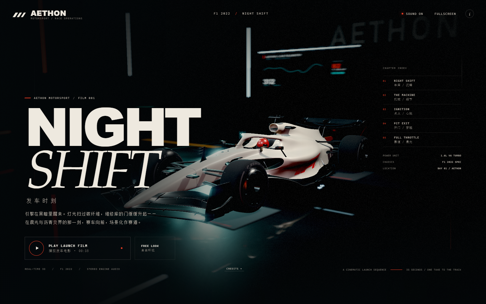
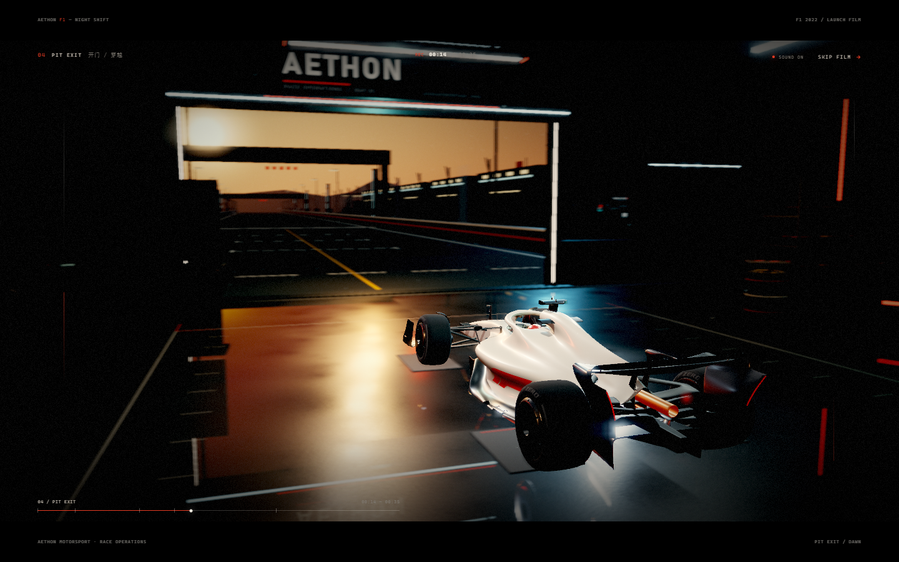
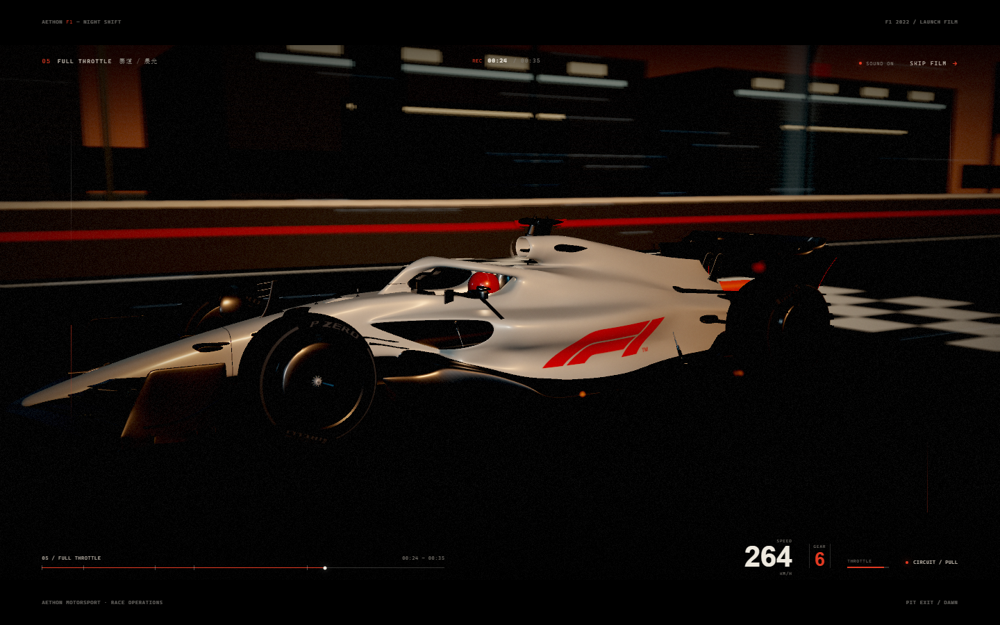
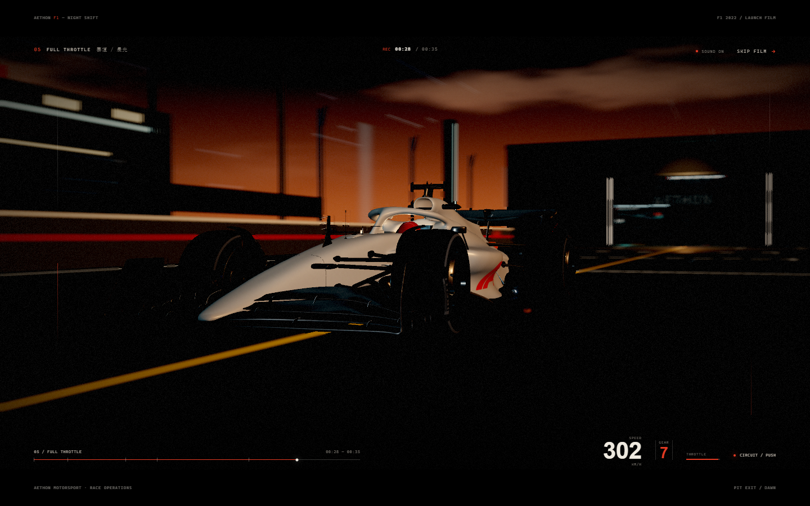
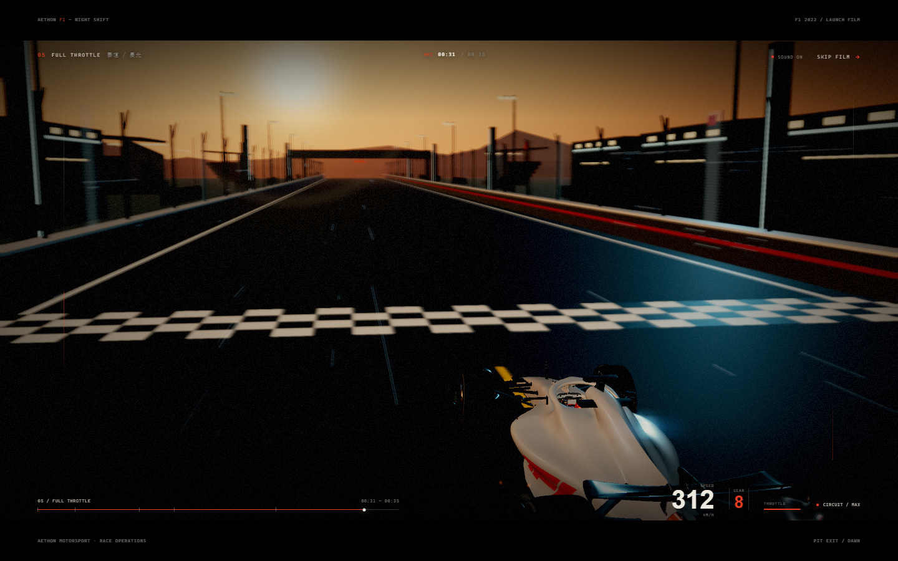

# AETHON F1 2022 — NIGHT SHIFT

一部实时渲染的 F1 发车电影：从夜间的 AETHON 维修库出发，穿过升起的卷帘门，在连续镜头里无缝进入晨光中的赛道。

本仓库同时收录 **V1 技术剖视版** 与 **V2 电影发车版**。

> **上一版（V1）完整保留在 [`legacy/f1-garage`](legacy/f1-garage/README.md)。** 它包含完整装配、工程剖视、半剖扫描与爆炸拆解，并保持为可直接打开的离线单文件。V2 是独立的新作，聚焦真实 F1 车型、影视级光影、电影运镜，以及赛车驶向赛道的无缝转场。



## 新增内容

- **真实 F1 2022 车型**：使用 TheoDevF1 的 F1 2022 赛车模型，约 89 万三角面，包含单体壳、halo、悬挂、刹车、轮胎、2022 规则前翼/尾翼、内燃机与混动总成等结构。没有用程序化几何替代车辆主体。
- **材质与细节升级**：车漆 clearcoat 与柔和反射、碳纤维 bump/roughness、金属轮毂、Pirelli 轮胎纹理、座舱车手、发光雨灯与排气热度。
- **影视级光影**：冷调车库底光、暖色门口晨光、灯带反射、体积光雾、PMREM 环境反射、ACES 色调映射、Bloom、横向 anamorphic 拉丝、镜头色散、暗角、颗粒、太阳 flare。
- **电影级运镜**：9 个镜头，35 秒，包含低角度后翼、前翼、侧箱、座舱、开门、车后跟随、侧面跟拍、低机位迎面、远景追逐。
- **无缝场景转场**：从维修库内开始，镜头跟随赛车穿过真实升起的卷帘门；门外赛道在同一镜头中展开，没有换场、切黑或资产替换。
- **最后一镜赛车向前**：赛车驶过发车格与晨光中的龙门架，镜头升高拉远，留下赛道与逐渐远去的车影。
- **程序化声音**：Web Audio 合成 V6 引擎、涡轮、风噪、轮胎、卷帘门伺服与低频氛围；支持静音。
- **选择性景深与运动模糊**：车体单独渲染遮罩，背景做选择性失焦与径向速度模糊，主体保持清晰。
- **完整交互**：首屏电影海报、播放/跳过、章节进度、实时速度/档位/油门 HUD、重播、自由环视、返回车库、credits 与全屏。




## 运行

环境：Node.js 20+，Chrome 或 Chromium（验证时使用 Chrome 的 D3D11 后端）。

```bash
cd f1-cinematic
npm install
npm run build
npm run preview
# http://127.0.0.1:4199
```

也可以直接使用已构建的 `dist/`：

```bash
npm run preview
```

**需要用 HTTP 服务器打开。** 27 MB 的真实 F1 GLB 作为独立资产放在 `dist/assets/f1-2022.glb`，浏览器在 `file://` 下会因 CORS 拒绝加载。V1 `legacy/f1-garage/dist/index.html` 仍是完全内联的单文件，可直接双击打开。

## 操作

| 操作 | 功能 |
| --- | --- |
| 点击 PLAY LAUNCH FILM / `Space` | 播放 35 秒发车电影 |
| `Esc` | 跳过电影 / 关闭 credits |
| `M` | 声音开关 |
| `F` | 全屏 |
| `R` | 结尾/自由环视时重播 |
| `G` | 返回车库 |
| 拖拽 / 滚轮 | 自由环视时环绕车辆、缩放 |

## 影片结构

| 章节 | 时间 | 内容 |
| --- | --- | --- |
| 01 NIGHT SHIFT | 00:00–03.6 | 黑暗车库，后翼与雨灯，灯光渐亮 |
| 02 THE MACHINE | 03.6–09.8 | 前翼、侧箱、轮胎与悬挂细节 |
| 03 IGNITION | 09.8–13.2 | 座舱、车手、引擎点火与整车震动 |
| 04 PIT EXIT | 13.2–23.0 | 卷帘门升起，赛车驶出，连续穿过门槛进入赛道 |
| 05 FULL THROTTLE | 23.0–35.0 | 侧面跟拍、低机位迎面、发车格、龙门架与晨光远景 |




## 项目结构

```text
f1-cinematic/
├─ assets/
│  ├─ f1-2022.glb           # TheoDevF1 / CC BY 4.0
│  └─ MODEL-CREDIT.md       # 模型来源与许可
├─ src/
│  ├─ main.js               # 场景、状态机、渲染循环
│  ├─ film.js               # 35 秒时间线、镜头、车体运动
│  ├─ ui.js                 # 电影海报 / HUD / 章节 / 结尾卡片
│  ├─ audio.js              # 程序化 V6、风噪、卷帘门声音
│  ├─ effects.js            # 速度线、火花
│  ├─ postfx.js             # Bloom / DOF / 拉丝 / 色散 / ACES
│  ├─ f1/vehicle.js         # GLB 加载、材质升级、车轮转动、车手
│  ├─ f1/garage.js          # AETHON 维修库、卷帘门、灯光
│  ├─ f1/track.js           # 晨光赛道、看台、龙门架、天空
│  └─ lib/                  # 几何、纹理、静态合并
├─ scripts/
│  ├─ build.mjs             # 构建并复制 GLB
│  ├─ serve.mjs             # 本地静态服务器
│  ├─ capture.mjs           # 重拍预览截图
│  ├─ verify.mjs            # 自动化交互回归测试
│  └─ harness.mjs           # 测试共用浏览器/服务器工具
├─ legacy/f1-garage/        # 完整保留的 V1 技术剖视版（含单文件 dist）
├─ dist/                    # V2 构建结果（由 npm run build 生成，不提交）
├─ preview-*.png            # 预览截图
└─ README.md
```

## 技术要点

- Three.js `0.186.1` / WebGL2；无外部 CDN、无运行时贴图下载。
- 车库和赛道分别进行静态合并，减少 draw call；赛车在车轮拆组后按材质合并车体。
- 真实车体约 **893k triangles**；使用 `PMREM` 环境贴图 + `MeshPhysicalMaterial`。
- 反光地面使用 `Reflector`，只在车库/门内镜头保留。
- 车辆单独渲染进 1/2 分辨率遮罩，用于选择性 DOF 与背景速度模糊。
- 玻璃/雨灯/刹车/排气/驾驶舱有独立材质和发光响应。
- 测试环境（headless Chrome，D3D11）：1440×900 约 **85–90 fps**；390×844 约 **149 fps**。实际帧率取决于设备与 DPR。

## 验证

```bash
npm run verify
```

覆盖：启动、首屏、播放、音频上下文、声音开关、跳过、结尾卡片、重播、赛道自由环视、返回车库、credits、移动端布局与无控制台错误。

本次交付运行 `npm run verify` 结果为 **24/24 通过**。当前机器上的 Chrome 路径是 `C:/Program Files/Google/Chrome/Application/chrome.exe`；其他机器可通过 `CHROME_PATH` 指定。

## 资产许可与致谢

- **F1 2022 car model** — TheoDevF1, reupload by Hydra_Junie, hosted via FetchCFD (Alges Mann). Licensed under **CC BY 4.0**.  
  来源：[Sketchfab — F1 2022 Generic V3](https://sketchfab.com/3d-models/f1-2022-generic-v3-reuploaded-from-theodevf1-55c119e7096a4322bc375c9b4f5a162d) · [FetchCFD — Formula 1 2022](https://fetchcfd.com/view-project/2898) · [CC BY 4.0](https://creativecommons.org/licenses/by/4.0/)
- 模型在本项目中被缩放、居中，升级为物理材质；车轮被拆分用于旋转；车体按材质合并，并添加车手、灯光、特效与电影化场景。原始几何和纹理来自上述模型。
- **AETHON**、**NIGHT SHIFT**、车辆号码与所有车队标识均为虚构，用于非商业概念短片。本项目与 Formula 1、FIA 或任何 F1 车队无关联。F1 及相关标识归其权利人所有。

---

**旧版**：[`legacy/f1-garage`](legacy/f1-garage/README.md) — 完整装配 / 工程剖视 / 半剖扫描 / 爆炸拆解 / 单文件离线版。
