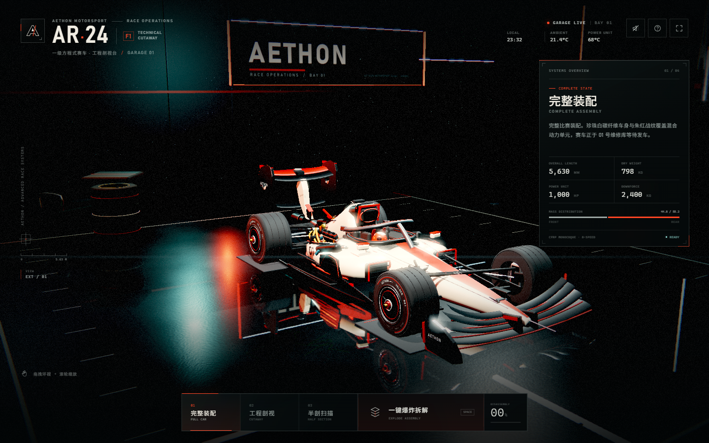
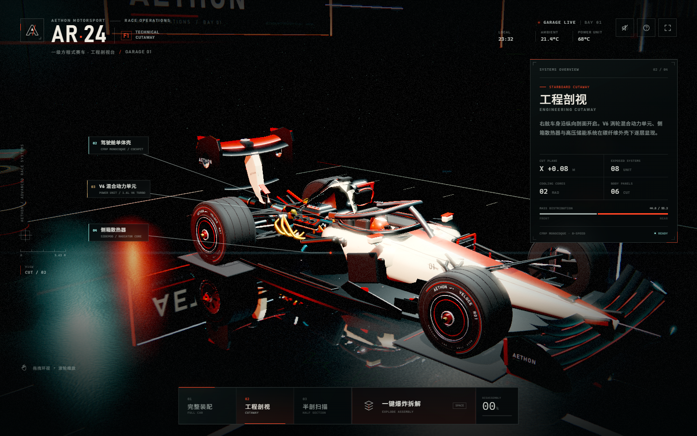
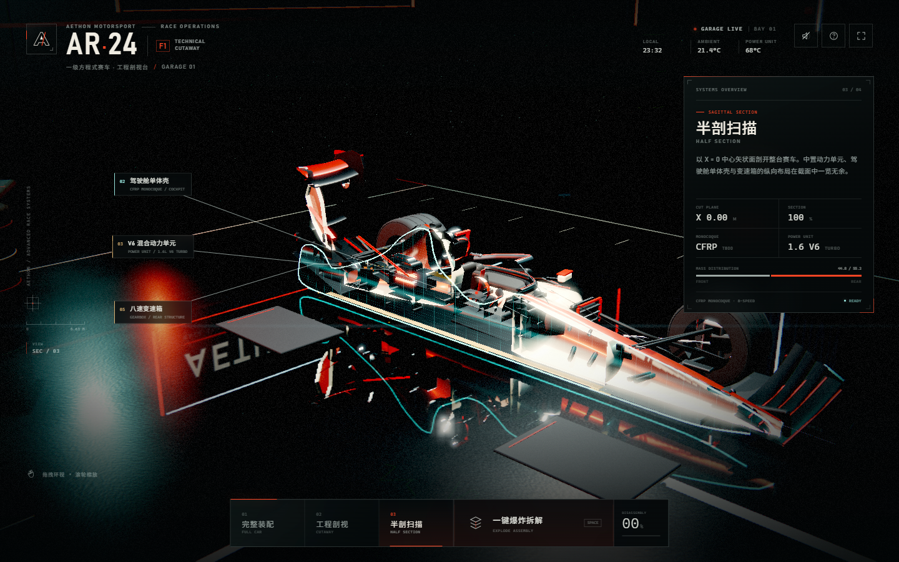
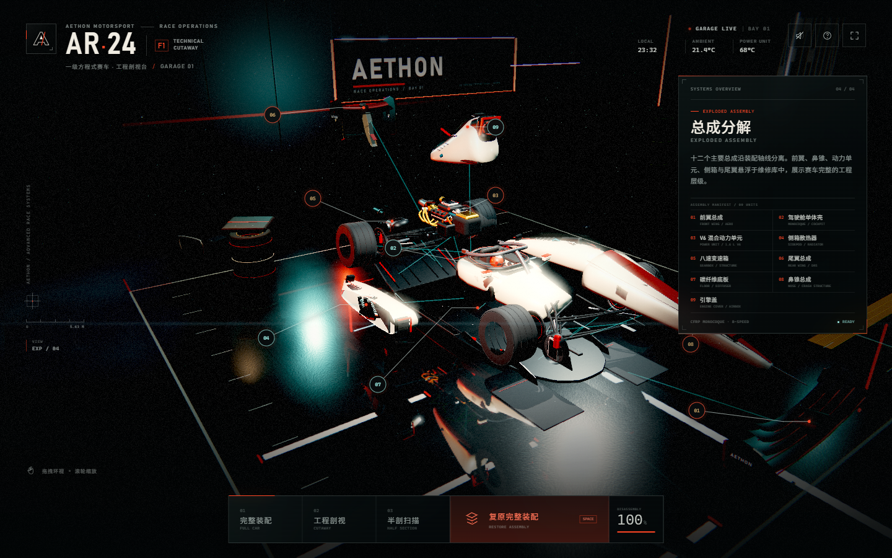
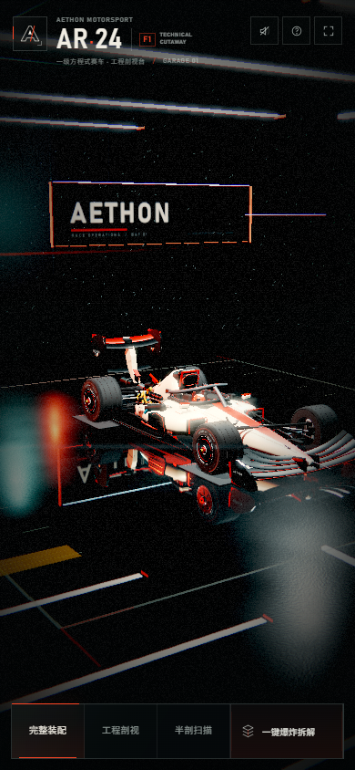

# AETHON AR·24 — F1 技术剖视台

一台程序化建模的一级方程式赛车，停放在夜间维修库中。模型、材质、灯光与库房
全部由代码实时生成，不依赖任何外部模型或贴图资源。支持完整装配、工程剖视、
半剖扫描与一键爆炸拆解。



## 四种检视状态

| 模式 | 说明 |
| --- | --- |
| **完整装配** | 在 01 号维修库中呈现赛车全貌。碳纤维车身、空气动力学套件与混合动力单元处于比赛装配状态。 |
| **工程剖视** | 沿右舷纵向打开车身面板，露出 V6 涡轮混合动力单元、散热器、高压电池与碳纤维单体壳。 |
| **半剖扫描** | 以 X = 0 中心矢状面剖开整车，并以发光截面轮廓、扫描网格和部位标注呈现内部布局。 |
| **爆炸拆解** | 一键将前翼、鼻锥、单体壳、侧箱、动力单元、变速箱、底板与尾翼沿装配轴线分离，并显示总成清单。 |

### 工程剖视


### 半剖扫描


### 总成分解


### 移动端


## 运行

直接双击打开 `dist/index.html` 即可。它是单文件构建，内联全部 JavaScript、
CSS 与程序化纹理，可离线运行。

也可以从源码启动：

```bash
npm install
npm run build
npm run preview
```

打开 <http://127.0.0.1:4197>。

## 操作

| 输入 | 功能 |
| --- | --- |
| 拖拽 / 滚轮 | 环视 / 缩放 |
| `1` | 完整装配 |
| `2` | 工程剖视 |
| `3` | 半剖扫描 |
| `4` 或 `Space` | 进入 / 退出爆炸拆解 |
| `R` | 重置当前视图机位 |
| `H` | 隐藏 / 恢复 HUD |
| `M` | 环境音开关 |
| `F` | 全屏 |
| `Esc` | 关闭帮助面板 |

底部模式栏、爆炸拆解按钮、右上角声音 / 帮助 / 全屏按钮也可直接操作。
在剖视和半剖模式下，默认机位从赛车右舷观察，正是被剖开的一侧。

## 技术说明

- **渲染**：Three.js WebGL2，自定义 4 重后期管线（阈值泛光、双尺度模糊、
  ACES 色调映射、色度偏移、暗角、颗粒与扫描线）。
- **赛车模型**：全部程序化几何。超椭圆截面放样构成鼻锥、单体壳、引擎盖与
  侧箱；NACA 衍生翼型生成前翼与尾翼；轮胎由旋转轮廓与侧壁印刷层构成。
  内部包含 V6 缸体、涡轮、排气、散热器、高压电池、驾驶舱、HANS、方向盘、
  六点式安全带与车手头盔。
- **维修库**：抛光混凝土地面使用实时平面反射（半帧率、768px 反射纹理），
  搭配程序化胎痕、伸缩缝与地面划线的多层材质。桁架、灯架、轮胎堆、工具柜、
  工作台与 AETHON 灯箱均使用程序化几何与 Canvas 贴图。
- **剖视**：使用独立裁剪平面。剖视模式只裁剪外部蒙皮，半剖模式裁剪整车；
  对应的截面轮廓根据车身中心剖面重新构建，并叠加扫描扰动与测量刻度。
- **爆炸拆解**：16 个装配组沿各自轴向位移/旋转，带延迟与缓动；同时生成
  青色装配轴线，展示零件从哪里拆出。
- **性能**：构建后自动按材质合并静态网格（每总成独立，保留拆解能力），
  阴影图仅在车辆运动或剖切变化时刷新，反射按半帧率更新，最高 MSAA ×2。
  在 1440 × 900 下的实际帧率取决于显卡。

## 目录

```
src/
  main.js               场景、交互、模式状态与 HUD 逻辑
  postfx.js             自定义后期处理
  styles.css            HUD / 响应式样式
  index.html            页面结构
  f1/
    car.js              赛车总装、车身与爆炸拆解层级
    aero.js             前翼、尾翼、底板与扩散器
    wheels.js           轮胎、轮辋、轮毂盖与制动系统
    internals.js        动力单元、座舱、车手与散热器
    materials.js        涂装、碳纤维与功能材质
    garage.js           维修库、灯光、道具与环境
  lib/                  放样、翼型、纹理与网格合批工具
scripts/
  build.mjs             构建单文件 dist/index.html
  serve.mjs             本地预览服务器
  capture.mjs           生成预览图
  verify.mjs            Playwright 交互验证
```

## 验证

```bash
npm run build
npm run preview       # 另一个终端
npm run verify
```

验证脚本使用本机 Chrome（`C:\Program Files\Google\Chrome\Application\chrome.exe`），
检查启动、四种模式、键盘快捷键、爆炸复原、帮助面板、HUD 隐藏与环境音按钮。

## 说明

AETHON 车队、AR·24 赛车及全部标识均为虚构概念设计，与 Formula 1、
FIA 或任何真实车队、制造商无关。本项目用于视觉与技术演示。
